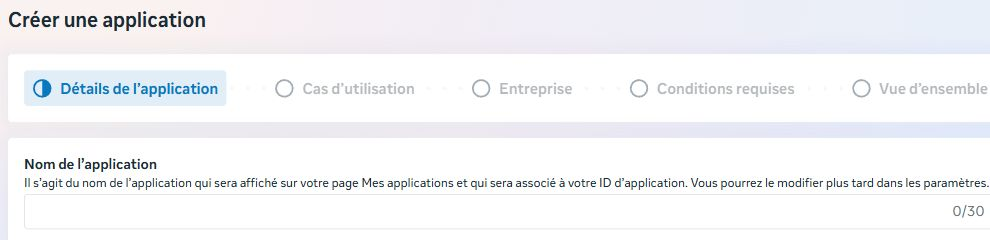
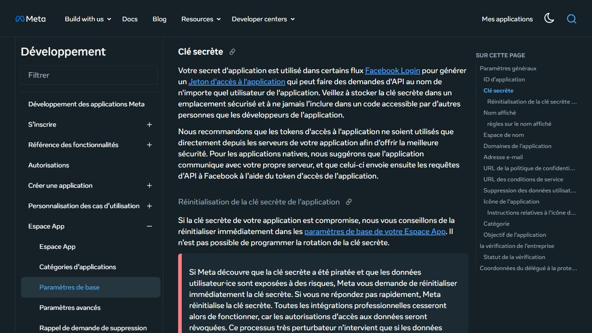
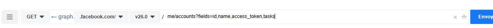
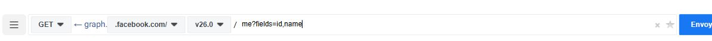

# ربط صفحة فيسبوك: Page ID وApp Secret وPage access token

هذا دليل إعداد النشر الاختياري. `build.py` يجهز الملفات محلياً، و`publish.py` يستطيع رفع الصورة ونشر النص والمصادر على صفحتك عبر Meta Graph API. الوضع الافتراضي معاينة دون اتصال؛ النشر يحتاج اختياراً صريحاً. لا يلزم الربط لتجربة الرسم والبرومبتات.

## 1. أنشئ التطبيق

1. افتح [Meta for Developers](https://developers.facebook.com/apps/) وسجّل الدخول بحساب يستطيع إدارة صفحتك.
2. اختر إنشاء تطبيق، ثم حالة الاستخدام **Manage everything on your Page** عندما تظهر ضمن الخيارات. راجع [دليل إنشاء تطبيق Pages API](https://developers.facebook.com/documentation/pages-api/create-an-app) إذا اختلفت الواجهة.
3. من Dashboard افتح تخصيص حالة الاستخدام، وأضف الصلاحيات المطلوبة للعملية. لا تطلب صلاحيات الرسائل أو الإعلانات لمجرد نشر منشور.
4. تحتاج إلى صفحة تستطيع تنفيذ مهمة `CREATE_CONTENT` عليها؛ اسم الصفحة أو عنوانها وحده لا يمنحان صلاحية النشر.



لقطة حقيقية لخطوة تفاصيل التطبيق قبل الإرسال. يظهر الاسم والحالات التالية فقط؛ حُذفت بيانات الحساب من مساحة الالتقاط. تختلف لغة الواجهة حسب حسابك.

## 2. أين أجد App ID وApp Secret؟

افتح **App settings → Basic** داخل التطبيق. ستجد **App ID** و**App Secret**؛ استخدم زر إظهار السر عند الحاجة وأكمل تحقق Meta الذي يظهر لك.

- `App ID`: معرّف التطبيق، وليس معرّف الصفحة.
- `App Secret`: سر التطبيق لتدفقات المصادقة على الخادم. لا تستخدمه بدلاً من توكن الصفحة، ولا تضعه في GitHub أو شيفرة المتصفح أو صورة توضيحية.
- `Page ID`: معرّف صفحة فيسبوك التي ستعمل عليها.
- `User access token`: توكن المستخدم الذي تستخدمه لاكتشاف الصفحات المسموح له بإدارتها.
- `Page access token`: توكن الصفحة الذي تستخدمه لطلب واجهتها باسمها.

يمكن استخراج توكن الصفحة عبر Graph API Explorer دون لصق App Secret في سكربت الرسم. توضح [إعدادات Meta الأساسية](https://developers.facebook.com/documentation/development/create-an-app/app-dashboard/basic-settings) دور السر ومكانه.



هذه لقطة من **التوثيق الرسمي** تشرح السر، وليست لوحة إعداد تطبيق تجريبي أو اختبار إصدار توكن. لا يحتاج `publish.py` إلى App Secret أو App ID؛ يحتاج توكن الصفحة ومعرّفها وإصدار الواجهة فقط.

## 3. احصل على Page ID وتوكن الصفحة

1. افتح [Graph API Explorer](https://developers.facebook.com/tools/explorer/) واختر تطبيقك من قائمة Meta App.
2. اختر الحصول على **User access token**، وأضف `pages_show_list` و`pages_manage_posts` وصلاحيات القراءة والاعتماديات التي تطلبها لوحة Meta. من صلاحيات القراءة الموثقة `pages_read_engagement`؛ راجع [دليل المنشورات](https://developers.facebook.com/documentation/pages-api/posts). قد تظهر متطلبات إضافية حسب العملية وحالة الاستخدام.
3. سجّل الدخول واسمح بالوصول إلى الصفحة المطلوبة. تأكد من منح حسابك إمكانية إنشاء محتوى عليها.
4. نفّذ طلب **GET** التالي داخل Explorer، باستخدام توكن المستخدم:

```text
/me/accounts?fields=id,name,access_token,tasks
```



لقطة إعداد GET داخل Explorer، قبل الإرسال. لا تتضمن توكناً أو نتيجة طلب.

5. في `data` ابحث عن الكائن الذي يطابق اسم صفحتك. قيمة `id` فيه هي **Page ID**، وقيمة `access_token` هي **Page access token**. لا تنسخ معرّف حسابك الشخصي أو توكن صفحة أخرى. افحص `tasks` وإمكانية إنشاء المحتوى.
6. اختر توكن الصفحة في قائمة **User or Page**. لاختبار القراءة فقط، نفّذ **GET**:

```text
/me?fields=id,name
```

يجب أن يعيد طلب `/me` **عند استخدام توكن الصفحة** معرّف الصفحة واسمها. هذا مهم لأن الناشر يقارن هوية التوكن بـPage ID؛ نجاح قراءة كائن صفحة عامة بتوكن مستخدم لا يثبت أن التوكن هو توكن تلك الصفحة. نجاح القراءة لا يثبت منح كل صلاحيات النشر. إذا كانت `data` فارغة في طلب الصفحات، راجع اختيار التطبيق وتوكن المستخدم والصلاحيات والوصول إلى الصفحة.



لقطة إعداد فحص الهوية فقط؛ لم نرسل الطلب ولم نعرض بيانات صفحة أو توكن.

## 4. احفظ إعدادات الناشر محلياً

انسخ `.env.example` إلى ملف `.env` خاص داخل مجلد المثال، ثم عدّل القيم محلياً. على PowerShell:

```powershell
Copy-Item .env.example .env
```

القيم التي يقرأها `publish.py` هي:

```dotenv
FACEBOOK_PAGE_ID=YOUR_PAGE_ID
FACEBOOK_PAGE_ACCESS_TOKEN=YOUR_PAGE_ACCESS_TOKEN
FACEBOOK_GRAPH_VERSION=v26.0
```

إصدار `v26.0` هو المثال الظاهر في توثيق Meta عند المراجعة؛ طابقه مع الإصدار المدعوم المختار لتطبيقك. الملف يقرأ `KEY=value` فقط؛ لا تستخدم أوامر shell أو توسعة متغيرات. متغيرات بيئة النظام تتقدم على قيم الملف عند وجودها. لا تضع القيم في ملف قصة أو لقطة شاشة أو سجلات عامة. سر التطبيق ليس بديلاً لتوكن الصفحة؛ احتفظ به منفصلاً فقط إذا احتاجته طريقة إصدار التوكن. راجع صلاحية التوكن ونوعه وصلاحياته عبر أدوات Meta؛ لا تفترض أنه سيبقى صالحاً إلى الأبد.

## 5. عاين ثم افحص الاتصال

بعد إعداد `story.json` بمصادر حقيقية ومراجعته مع `demo=false` و`reviewed=true`، أنشئ الحزمة بأمر `build.py`. لا تحوّل بيانات العرض إلى مادة حقيقية بتغيير العلامة فقط.

```powershell
.venv\Scripts\python.exe build.py --input story.json --out output/my-first-post
.venv\Scripts\python.exe publish.py --package output/my-first-post
.venv\Scripts\python.exe publish.py --package output/my-first-post --env-file .env --check-connection
```

الأمر الثاني معاينة محلية بلا شبكة أو توكن. الأمر الثالث يرسل GET فقط إلى `/me?fields=id,name` ويعرض هوية الصفحة إذا طابقت إعداداتك؛ لا ينشر شيئاً. راجع الصورة وحقوقها والنص وروابط المصادر بنفسك قبل الخطوة التالية.

## 6. انشر الصورة والنص فعلياً

استبدل `YOUR_PAGE_ID` بالمعرّف الرقمي الذي راجعته. **الأمر التالي ينشر فوراً على صفحتك**:

```powershell
.venv\Scripts\python.exe publish.py --package output/my-first-post --env-file .env --publish --confirm-page-id YOUR_PAGE_ID
```

على Linux/macOS استخدم `.venv/bin/python` بدلاً من مسار Windows. يتحقق السكربت من هوية توكن الصفحة أولاً، ثم يرفع `post.png` كملف إلى `/{PAGE_ID}/photos` مع `caption` الذي يجمع النص وروابط المصادر، و`published=true`. [مرجع صور الصفحة](https://developers.facebook.com/docs/graph-api/reference/page/photos/) يشرح رفع ملف ووظيفة caption. حد 8 MiB وأبعاد 1080×1350 هما قيود هذا المثال، لا وصفاً لكل حدود Meta.

بعد استجابة تتضمن معرّف الصورة ومعرّف المنشور، يكتب `facebook-receipt.json` ويحفظ الإيصال في السجل المشترك `output/facebook-publish-state.sqlite3`. رابط المنشور مبني من معرّف المنشور كما يوضح [دليل Meta](https://developers.facebook.com/documentation/pages-api/posts). افتح الرابط وتحقق من ظهوره؛ لم نجرِ هذا الاختبار على صفحة حقيقية ضمن إعداد الدليل.

## 7. الأخطاء ومنع التكرار

يرفض الناشر البيانات التجريبية، المادة غير المراجعة، اختلاف النص أو المصادر عن `story.json`، صورة تالفة أو بمقاس مختلف، وهوية توكن لا تطابق Page ID. يحفظ بصمة الصورة والنص في سجل مشترك، فيمنع إعادة الطلب نفسه حتى لو نُسخ مجلد الحزمة.

بعد انقطاع اتصال أو استجابة غير مكتملة، تصبح الحالة `unknown` أو تبقى `pending` إذا توقف البرنامج؛ افحص الصفحة وسجل النشر قبل اتخاذ أي قرار. لا توجد إعادة محاولة تلقائية ولا خيار لتجاوز هذه الحالات. إذا رفضت Meta الطلب صراحة وكان مسجلاً `rejected`، أصلح السبب ثم أعد الأمر يدوياً. لا تحذف السجل ولا تنشئ نسخة أخرى منه لمحاولة تجاوز حظر التكرار. تغيير `--state` أو نسخ المشروع إلى جهاز آخر ينشئ نطاق منع تكرار مختلفاً؛ الحماية ليست ضماناً عالمياً.

إذا ظهر خطأ، افحص الملفات والعلامات وهوية التوكن والصلاحيات، ثم راجع حالة التطبيق في لوحة Meta. البرنامج لا يعرض نصوص أخطاء مزود الخدمة الخام أو التوكنات. انتهت 19 تجربة محلية بنجاح باستخدام محاكاة الردود؛ يشمل ذلك شكل الطلب الفعلي، الرفض والتكرار والمهلة. **لم نرسل منشوراً حياً إلى فيسبوك**، ولذلك لا تدل الاختبارات على قبول Meta لتطبيقك أو صلاحيات حسابك.

يتضمن المثال ناشراً عند الطلب، ولا يتضمن مهمة يومية سحابية أو تجديد توكن أو توليد محتوى بالذكاء الاصطناعي. قبل توفير الربط لصفحات أشخاص آخرين، اتبع متطلبات Meta التي تظهر لتطبيقك، بما فيها App Review والتحقق من النشاط التجاري عندما يكون مطلوباً، وسياسة الخصوصية وحذف البيانات. نجاح تجربة على صفحتك لا يعني الموافقة على استخدام عام.

آخر مراجعة للتوثيق: 31 أكتوبر 2026. قد تتغير مسميات الواجهة والمتطلبات؛ اتبع حالة التطبيق والصلاحيات في لوحة Meta الحالية.
